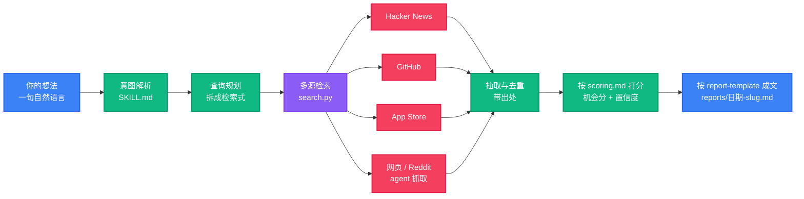

<div align="center">

# IdeaGo Skill

**在编码 agent 里验证一条产品想法。**

IdeaGo 会检索网页、Hacker News、GitHub、Reddit 和 App Store，然后写出一份决策优先的报告：结论、痛点信号、付费意愿、市场空缺、竞品、带出处的证据，以及置信度。

[](skills/ideago/scripts/search.py)
[](skills/ideago/SKILL.md)
[](skills/ideago/SKILL.md)
[](https://github.com/Tendo33/IdeaGo)

[](LICENSE)

[安装](#安装) · [使用](#使用) · [它是怎么跑的](#它是怎么跑的) · [示例](#示例)

<sub>中文</sub>

</div>

---

## 这是什么

这个分支把原来的托管 Web 应用换成了一个 agent skill。Web 应用仍在 `main`（自托管）和 `saas`（托管）分支上。

不是查竞品列表的工具：报告围绕「这个方向值不值得做」来组织，竞品只是其中一节。

| 报告部分 | 回答什么 |
| --- | --- |
| 结论 | 建议做、谨慎做，还是不做 |
| 痛点信号 | 用户真的在抱怨什么，出处在哪 |
| 付费意愿 | 有没有人为这类问题掏过钱 |
| 市场空缺 | 现有方案没覆盖的地方 |
| 竞品 | 谁在做，做得怎么样 |
| 证据 | 每条结论来自哪个平台 |
| 置信度 | 证据够不够支撑这个结论 |

## 安装

把 `skills/ideago` 复制或软链到你的 agent 的 skills 目录：

```bash
# Claude Code（用户级）
ln -s "$(pwd)/skills/ideago" ~/.claude/skills/ideago

# Codex
ln -s "$(pwd)/skills/ideago" ~/.codex/skills/ideago
```

依赖只有 Python 3.9+ 标准库，以及一个能联网搜索和抓页面的 agent。

GitHub 检索建议配置 `GITHUB_TOKEN` 或 `GH_TOKEN`，或者用 `gh` 登录；这是可选的，但能避免触发限流。

## 使用

用自然语言提问即可：

- 「帮我验证一下这个想法：给 Claude Code 做一个桌面 GUI」
- "Is there demand for a habit tracker built for ADHD adults?"

报告会存到 `./reports/<日期>-<slug>.md`。

## 它是怎么跑的

一个 skill 没有服务端，所以流程就是 agent 按 `SKILL.md` 一步步走：



直接调检索脚本也可以：

```bash
python3 <skill-dir>/scripts/search.py all "<query 1>" "<query 2>" [--with-appstore --country us]
```

输出是归一化后的 JSON，agent 读完再写报告。

## 目录结构

```
skills/ideago/
  SKILL.md                      workflow: intent → query plan → gather → extract → synthesize → report
  references/scoring.md         机会分与置信度的计算公式
  references/report-template.md 报告结构
  scripts/search.py             HN / GitHub / App Store 检索，输出归一化 JSON
examples/                       一份完整报告示例
```

## 示例

完整报告见 [examples/2026-10-31-claude-code-desktop-gui.md](examples/2026-10-31-claude-code-desktop-gui.md)。

## License

MIT，见 [LICENSE](LICENSE)。
